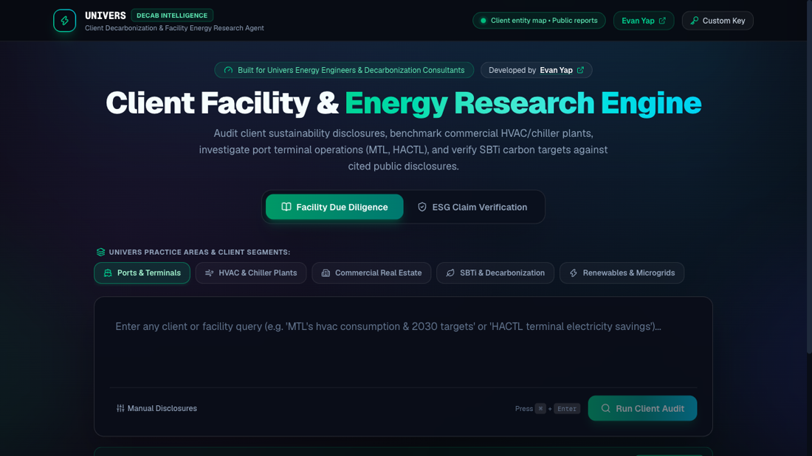
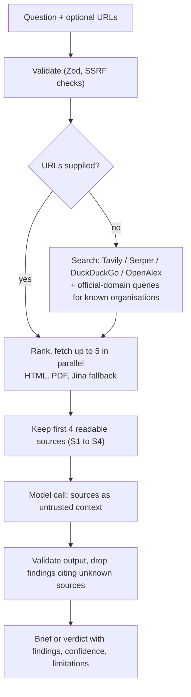

# AI Research Agent

A source-grounded research tool for energy engineers and decarbonisation consultants. For each question it retrieves public webpages and PDFs, then answers **using only that retrieved material**, with source-level citations, structured findings and an explicit list of limitations.

Built during my Univers internship.

**Live:** <https://approved-research-agent.vercel.app> · Next.js, TypeScript, Vercel AI SDK, Groq (Gemini fallback), Zod



## What it does

- **Facility due diligence.** Ask about a client facility, get a cited brief: summary, findings with confidence, limitations.
- **ESG claim verification.** Paste a claim, get a verdict (`VERIFIED`, `REFUTED`, `UNVERIFIED`), a 0-100 truth rating, supporting and contradicting evidence.
- **Preset practice areas:** ports and terminals, HVAC and chiller plants, commercial real estate, SBTi targets, renewables and microgrids.

## How it works



## Safeguards

- **Evidence only.** Any finding that cites a source ID that was not supplied is dropped in code before it reaches the UI.
- **Untrusted text.** Retrieved pages are treated as reference material; instructions inside them are ignored.
- **Bounded and validated.** Zod request validation, private and cloud-metadata addresses blocked (SSRF), 6 second fetch timeout, size caps.
- **Limitations are part of the schema.** Every response must state what the evidence does not cover.

## Known limitations

- No allowlist mode, so nothing guarantees a source is official. The UI lists every source so the reader can judge.
- The truth rating is the model's judgement, not a calibrated probability.
- Verdict accuracy and calibration are not measured yet. The [eval harness](evals/README.md) (`npm run eval`) is in place, but it needs 40 to 60 claims that I have labelled myself, and none are labelled yet. Citations are checked by hand from its spot-check list.

*The repository name is historical: the app does not restrict itself to a fixed list of approved sites.*

## Run it

Needs Node 20.9+ and a free [Groq key](https://console.groq.com) or a Gemini key.

```bash
git clone https://github.com/evanyap7/approved-research-agent.git
cd approved-research-agent
npm install
cp .env.example .env.local   # add GROQ_API_KEY (or GOOGLE_GENERATIVE_AI_API_KEY)
npm run dev                  # http://localhost:3000
```

Optional `TAVILY_API_KEY` or `SERPER_API_KEY` improve search. Deploys to Vercel on push.

## Next

Allowlist mode, the labelled claim set for the eval, page caching with freshness timestamps, Markdown/PDF export, saved history.
